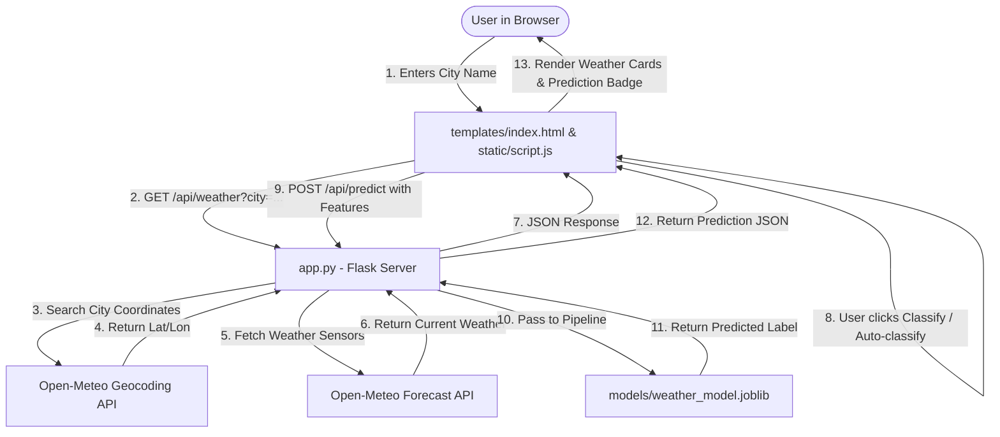

# Architecture Document

## 1. System Overview & Data Flow
The application follows a lightweight Model-View-Controller (MVC) architecture using Python and Flask, with client-side interactions handled via vanilla JavaScript and styling via modern responsive CSS.

---

## 2. Component Details

### A. Training Subsystem (`train_model.py`)
1. Reads `data/weather.csv`.
2. Selects physical sensor features:
   - `Temperature` (°C)
   - `Humidity` (%)
   - `Wind Speed` (km/h)
   - `Precipitation (%)` (%)
   - `Atmospheric Pressure` (hPa)
   - `UV Index`
   - `Visibility (km)`
3. Partitions data into 80% training set and 20% test set using stratified sampling.
4. Builds a scikit-learn `Pipeline`:
   - Step 1: `StandardScaler` (centers features to mean 0, variance 1)
   - Step 2: `SVC(kernel='rbf', probability=True)`
5. Evaluates model performance on the unseen test set (accuracy, precision, recall, F1-score).
6. Serializes the full pipeline, feature names, and evaluation scores together into `models/weather_model.joblib`.

### B. Backend Subsystem (`app.py`)
1. Loads the serialized model artifact into memory upon server startup.
2. Serves the main single-page application at `GET /`.
3. Exposes `GET /api/weather?city=<name>`:
   - Calls Open-Meteo Geocoding API to resolve coordinates.
   - Calls Open-Meteo Forecast API to retrieve current conditions.
   - Formats values to match training feature conventions (e.g. converting visibility meters to kilometers).
4. Exposes `POST /api/predict`:
   - Validates incoming feature payload.
   - Passes ordered features to the SVM pipeline.
   - Returns predicted weather class (`Sunny`, `Cloudy`, `Rainy`, `Snowy`) and class probabilities.
5. Exposes `GET /api/metrics`:
   - Returns model evaluation scores computed during training.

### C. Frontend Subsystem (`index.html`, `style.css`, `script.js`)
1. **HTML Structure:** Clean semantic markup with accessible labels, input controls, metric badges, weather cards, and error display banners.
2. **CSS Styling:** Responsive blue-and-white theme, card shadows, rounded corners, and micro-interactions.
3. **JavaScript Logic:**
   - Asynchronously communicates with backend endpoints using `fetch()`.
   - Manages UI states (loading spinner, error toast, data presentation).
   - Allows users to fetch live weather and run classification on demand.

---

## 3. Technology Stack Summary
| Technology | Role | Purpose |
| :--- | :--- | :--- |
| **Python 3** | Core Programming Language | Machine learning, data pipeline, and backend server |
| **Flask** | Web Framework | Routing, API endpoint definitions, template serving |
| **Scikit-learn** | Machine Learning Library | SVM classification, `StandardScaler`, and metrics |
| **Pandas** | Data Processing | CSV reading, feature extraction, and manipulation |
| **Joblib** | Model Persistence | Saving and loading trained scikit-learn pipelines |
| **Requests** | HTTP Client | Calling external Open-Meteo APIs securely |
| **HTML5 / CSS3** | User Interface | Page structure and blue-and-white visual styling |
| **Vanilla JS** | Client Interaction | Event listeners, AJAX calls, and DOM updates |

---

## 4. File-by-File Purpose
- `PRD.md`: Project requirements, goals, scope, and technical limitations.
- `Architecture.md`: System layout, flowcharts, and component descriptions.
- `rules.md`: Strict development and coding standards.
- `phases.md`: Seven development stages and tracking checklists.
- `design.md`: Visual styling specifications and design guidelines.
- `memory.md`: Living log of progress, errors encountered, and next steps.
- `train_model.py`: Training script for data preprocessing, model fitting, and evaluation.
- `app.py`: Flask web application and API service.
- `requirements.txt`: Python package requirements.
- `README.md`: Setup instructions and usage guide.
- `data/weather.csv`: Historical Kaggle weather dataset.
- `models/weather_model.joblib`: Serialized trained SVM pipeline with metrics.
- `templates/index.html`: Web dashboard HTML template.
- `static/style.css`: Dashboard CSS stylesheet.
- `static/script.js`: Dashboard dynamic user interface script.
